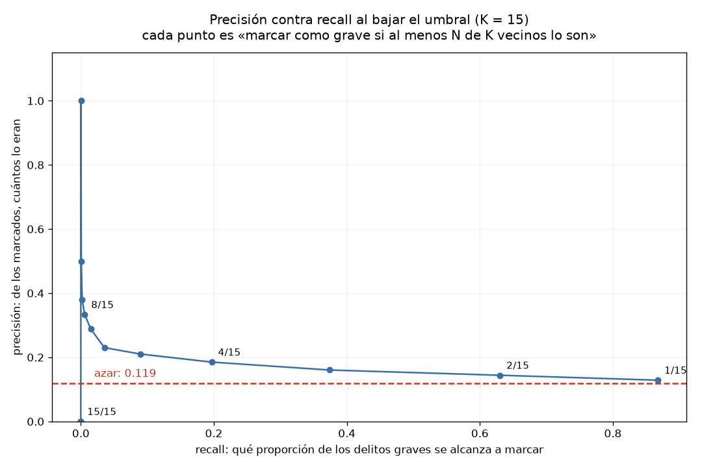

# Práctica 6 — Clasificación con KNN

```
python knn.py          # el reporte completo (queda en salida.txt)
python knn.py --demo   # comprueba las funciones con casos conocidos
```

Necesita `scikit-learn`.

## Qué es KNN

Es el clasificador más simple que existe. Para adivinar a qué clase pertenece algo
nuevo, mira a sus **K vecinos más cercanos** y le hace caso a la mayoría.

```
        A   A
     A    ✗    B       K = 3  ->  los 3 más cercanos son A, A, B
        A    B  B                 mayoría: A, se clasifica como A
          B
```

No aprende nada en el sentido normal: se guarda todos los datos y, cuando llega un
caso nuevo, mide distancias. Por eso hay que decidir tres cosas: **qué predecir**,
**con qué variables** medir la cercanía, y **cuánto vale K**.

---

## 1. Qué predecir

La consigna es clasificar, pero el objetivo obvio no sirve tal cual.
`categoria_delito` tiene 16 valores y uno solo, `DELITO DE BAJO IMPACTO`, se lleva el
88% de las denuncias. En la Práctica 2 eso quedó medido con la entropía de 0.23: la
columna tiene 16 etiquetas pero se comporta casi como si tuviera una.

Con 16 clases así de desbalanceadas, el modelo nunca vería suficientes ejemplos de
las chicas para aprender nada: `SECUESTRO` tiene 20 casos en todo el año.

Se juntan en dos clases: bajo impacto contra todo lo demás. Queda 88% contra 12%, que
sigue siendo desbalanceado pero es manejable, y la pregunta se vuelve concreta: ¿se
puede distinguir un delito grave de uno menor con lo que se sabe de la denuncia?

## 2. Con qué variables, y cuáles se excluyeron a propósito

Se usan cuatro: `latitud`, `longitud`, `hora_inicio` y `dias_para_denunciar`.

Se dejaron fuera `fiscalia`, `agencia` y `unidad_investigacion`. Estos son valores
reales de la columna `fiscalia`:

```
FISCALÍA DE INVESTIGACIÓN DEL DELITO DE SECUESTRO
FISCALÍA ESPECIALIZADA PARA LA INVESTIGACIÓN DEL DELITO DE FEMINICIDIO
FISCALÍA DE INVESTIGACIÓN ESTRATÉGICA DEL DELITO DE ROBO DE VEHÍCULOS
```

Si se usara `fiscalia` como variable de entrada, el modelo no estaría prediciendo
nada: estaría leyendo la respuesta por otro lado. Una denuncia atendida por la
`FISCALÍA DE INVESTIGACIÓN DEL DELITO DE SECUESTRO` es, obviamente, un secuestro.

Eso se llama **fuga de información**: cuando una variable de entrada contiene,
disfrazada, la respuesta que se quiere predecir. El modelo sale buenísimo y en
realidad no aprendió nada.

Aquí salta a la vista porque los nombres son explícitos, pero no siempre es tan
obvio. Por la misma razón se excluyen `agencia` y `unidad_investigacion`: a qué
unidad se asigna un caso depende en parte de qué tipo de delito es.

Las cuatro que quedan describen **cuándo** y **dónde** pasó el hecho y cuánto tardó
la denuncia, que es información que existe sin saber de qué delito se trata.

### Por qué hay que escalar las variables

KNN mide distancias, y las cuatro variables están en escalas incompatibles:

```
latitud                de 19.13 a 19.58    ->  rango de 0.45
dias_para_denunciar    de 0 a 23,991       ->  rango de 23,991
```

Sin escalar, moverse un día pesa más que cruzar la ciudad entera y las coordenadas
dejan de contar. Todas las variables se escalan antes de entrenar.

---

## 3. El resultado base, y por qué el accuracy engaña

```
filas usables   228,226   (se pierden 14,166 por nulos en latitud y longitud)
reparto         bajo impacto 88.09%    resto 11.91%
```

| modelo | accuracy | precisión | recall | graves marcados |
|---|---|---|---|---|
| siempre contesta "bajo impacto" | 0.8809 | 0.000 | 0.000 | 0 de 5,437 |
| KNN con K = 15 | 0.8802 | 0.333 | 0.006 | 32 de 5,437 |

Matriz de confusión del KNN:

| | predijo: bajo impacto | predijo: resto |
|---|---|---|
| **real: bajo impacto** | 40,145 | 64 |
| **real: resto** | 5,405 | 32 |

La matriz dice lo que el accuracy escondía. De los 45,646 casos de prueba, el modelo
contestó "bajo impacto" en 45,550, o sea el 99.7%. De los 5,437 delitos graves que
había, alcanzó a marcar **32**.

Y el número que lo delata: su accuracy de 0.8802 queda **por debajo** del modelo que
no mira nada (0.8809). Un modelo con cuatro variables, 182 mil filas de entrenamiento
y 15 vecinos es peor que contestar siempre lo mismo.

Eso pasa porque con clases desbalanceadas el accuracy premia acertarle a la clase
grande. Como el 88% de los casos son de bajo impacto, contestar siempre eso ya da
0.88, y cualquier intento de marcar graves solo puede empeorar el número.

Por eso no se puede reportar accuracy a secas. Hace falta la matriz de confusión, que
separa los cuatro casos posibles, y el **recall de la clase minoritaria**, que es la
única medida que nota la diferencia entre marcar 32 delitos graves y marcar cero.

Las dos medidas que sí distinguen:

```
precisión (de "resto")  =  de los que marqué como graves, ¿cuántos lo eran?
recall    (de "resto")  =  de los graves que había, ¿cuántos alcancé a marcar?
```

---

## 4. Variación B: entrenar con las clases balanceadas

Se recorta la clase mayoritaria al tamaño de la minoritaria: el entrenamiento pasa
de 182,580 filas a 43,498, con 21,749 de cada clase.

| K | accuracy | precisión | recall | F1 | graves marcados | falsas alarmas |
|---|---|---|---|---|---|---|
| 5 | 0.5405 | 0.146 | 0.587 | 0.233 | 3,192 | 18,728 |
| 15 | 0.5383 | 0.146 | 0.592 | 0.234 | 3,217 | 18,855 |
| 51 | 0.5289 | 0.148 | 0.624 | 0.240 | 3,392 | 19,459 |
| 101 | 0.5258 | 0.148 | 0.625 | 0.239 | 3,399 | 19,608 |

## 5. Variación C: bajar el umbral de decisión

En vez de pedir que la mayoría de los 15 vecinos sean graves, basta con que lo sean
N de 15.

| regla | accuracy | precisión | recall | F1 | graves marcados | falsas alarmas |
|---|---|---|---|---|---|---|
| 15 de 15 | 0.8809 | 0.000 | 0.000 | 0.000 | 0 | 0 |
| 8 de 15 (la mayoría) | 0.8802 | 0.333 | 0.006 | 0.012 | 32 | 64 |
| 4 de 15 | 0.8013 | 0.185 | 0.197 | 0.191 | 1,069 | 4,704 |
| 2 de 15 | 0.5101 | 0.144 | 0.630 | 0.235 | 3,427 | 20,352 |
| 1 de 15 | 0.2849 | 0.129 | 0.868 | 0.224 | 4,717 | 31,923 |



Las dos variaciones llegan casi al mismo lugar por caminos distintos: balancear con
K = 51 da recall 0.624, y bajar el umbral a 2 de 15 da 0.630. Tiene sentido, porque
las dos hacen lo mismo de fondo: quitarle al modelo el incentivo de contestar siempre
la clase grande.

Y las dos cobran lo mismo. El recall sube de 0.006 a 0.63, pero el accuracy cae de
0.88 a 0.51 y las falsas alarmas pasan de 64 a más de 20,000.

La gráfica muestra por qué no hay escapatoria. Cada punto es una regla distinta, y la
curva baja hacia la línea roja del azar apenas el recall pasa de 0.2. Donde la
precisión se ve alta, arriba a la izquierda, el recall es prácticamente cero: son los
casos donde el modelo marca 3 o 4 denuncias de 45,646, y acertarle a esas pocas no
sirve de nada.

La línea roja está en 0.119, que es la proporción de delitos graves en los datos: lo
que se acertaría marcando al azar. Si el modelo tuviera señal real, la curva se
mantendría despegada de esa línea a lo largo del recall. No lo hace: se le pega y ahí
se queda.

---

## 6. Variación D: ¿ayudan más variables?

La conclusión de arriba es comprobable: si el problema fueran las variables
escogidas, agregar otras debería mejorar algo. Todas entrenadas balanceadas con
K = 51.

| variables | accuracy | precisión | recall | F1 | graves marcados |
|---|---|---|---|---|---|
| 4 numéricas (original) | 0.5289 | 0.148 | 0.624 | 0.240 | 3,392 de 5,437 |
| + mes y día de semana | 0.5463 | 0.144 | 0.566 | 0.229 | 3,076 de 5,437 |
| + alcaldía | 0.5308 | 0.148 | 0.618 | 0.239 | 3,359 de 5,437 |
| todo junto | 0.5477 | 0.144 | 0.568 | 0.230 | 3,086 de 5,437 |
| solo latitud y longitud | 0.5371 | 0.145 | 0.588 | 0.232 | 3,198 de 5,438 |
| solo dias_para_denunciar | 0.2516 | 0.139 | 0.943 | 0.243 | 5,812 de 6,162 |

El F1 se queda entre 0.229 y 0.243 en todas las combinaciones. Agregar el mes y el
día de la semana lo baja; agregar la alcaldía lo deja igual; juntar todo tampoco
cambia nada.

El renglón más revelador es el de `solo latitud y longitud`: con dos variables saca F1
de 0.232, prácticamente lo mismo que las seis juntas. Lo poquito que el modelo logra
es geográfico, porque hay colonias donde la mezcla de delitos es distinta, y las demás
variables no aportan nada encima de eso.

Eso confirma que el problema no es qué cuatro variables se escogieron. Es que ninguna
de las disponibles distingue un delito grave de uno menor.

### El renglón de `solo dias_para_denunciar` engaña

Ese renglón tiene el F1 más alto de la tabla, 0.243, y hay que leerlo con cuidado.

```
marca como graves 5,812 de 6,162 reales    ->  recall 0.943, se ve excelente
pero marca el 86% de TODAS las denuncias   ->  precisión 0.139, el nivel del azar
```

Y la evidencia de que no distingue nada está en el entrenamiento balanceado: la
mediana de la variable escalada es −0.1429 en una clase y −0.1451 en la otra.
Prácticamente idéntica.

Ese renglón tiene el F1 más alto de la tabla y aun así es el peor modelo de todos.

Consigue recall de 0.943 marcando como graves el **86% de todas las denuncias**.
Acierta casi todos los graves porque marca casi todo, igual que un detector de
incendios que suena las 24 horas: nunca se le escapa un incendio y no sirve para
nada.

La evidencia de que no distingue está arriba: la mediana de la variable escalada es
−0.1429 en una clase y −0.1451 en la otra. Prácticamente idéntica. El modelo no tiene
de dónde agarrarse y acaba marcando por marcar.

**La advertencia que sale de aquí: el F1 también se puede engañar.** Un modelo que
marca casi todo consigue recall alto, y el recall arrastra el F1 hacia arriba sin que
el modelo distinga nada. Hay que mirar también cuántos casos marca en total, no solo
las métricas.

---

## 7. Conclusión

Las cuatro variables no contienen la información necesaria para distinguir un delito
grave de uno menor. No es que KNN sea un mal algoritmo: es que la señal no está en los
datos que se le dieron.

Lo que lo respalda:

- La precisión nunca pasó de 0.15 en ninguna variación, contra un azar de 0.119. Tres
  puntos arriba del azar.
- Agregar variables no movió el F1 de 0.23.
- Dos variables solas, latitud y longitud, dan lo mismo que seis.
- Con el umbral más agresivo, marcar el 87% de los graves cuesta 31,923 falsas
  alarmas.

Un modelo útil tendría que ver algo que estos datos no registran: qué se robaron, si
hubo arma, si hubo lesionados. La carpeta sí tiene esa información en el expediente,
pero no en las columnas que publica el portal de datos abiertos.

La práctica contestó que no se puede, y comprobó por qué.

### Lo que esto cruza con las prácticas 3 y 4

En la Práctica 4 quedó comprobado que `dias_para_denunciar` **sí** difiere entre
categorías, con delta de Cliff de hasta 0.70 y p-values de 10⁻²²⁷. Aquí esa misma
variable no sirve para clasificar.

En la Práctica 4 quedó comprobado que `dias_para_denunciar` difiere entre categorías,
con delta de Cliff de hasta 0.70 y p-values de 10⁻²²⁷. Aquí la misma variable no
clasifica nada. Las dos cosas son ciertas.

La respuesta está en el boxplot de la Práctica 3. Las medianas de los grupos estaban
en lugares distintos, pero las cajas se encimaban casi por completo. Una denuncia con
2 días de rezago puede ser de cualquier categoría.

Saber que un grupo tiene mediana 0 y otro mediana 7 no sirve para clasificar un caso
suelto cuando los dos grupos van de 0 a 23,991 días.

**Una diferencia entre grupos no implica que se pueda predecir el individuo.** Es el
hallazgo más útil de esta práctica, y sale de cruzar tres entregas.
