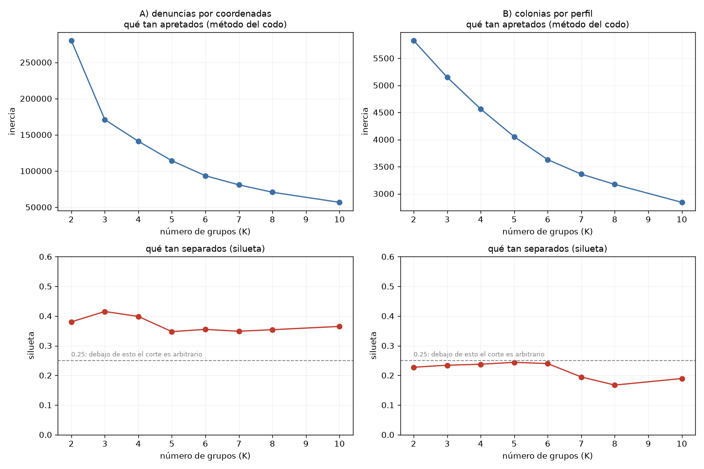
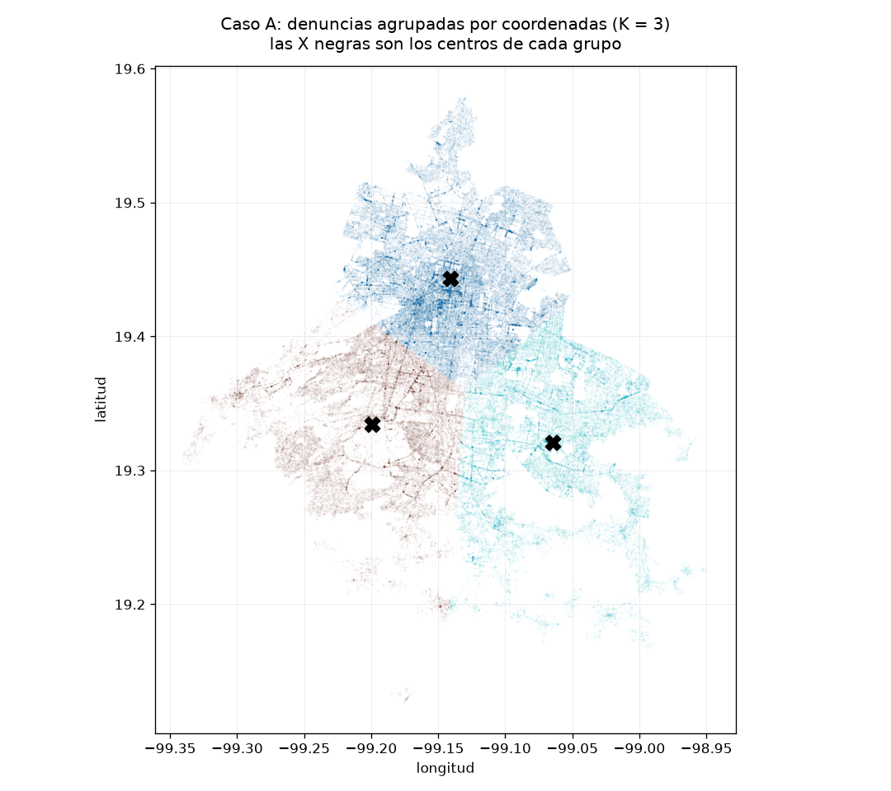

# Práctica 7 — Clustering con K-Means

```
python kmeans.py          # el reporte completo (queda en salida.txt)
python kmeans.py --demo   # comprueba las funciones con casos conocidos
```

Usa `scikit-learn` y `matplotlib`, que ya estaban.

## Qué es K-Means, y en qué se diferencia de la Práctica 6

En la Práctica 6 el modelo tenía la respuesta correcta para aprender: se sabía qué
denuncias eran de bajo impacto. Eso es aprendizaje **supervisado**.

K-Means es **no supervisado**: no hay respuesta correcta. Se le dice "pártelo en K
grupos" y los arma solo, juntando lo que está cerca.

```
1. avienta K puntos al azar (los centros)
2. cada dato se va con el centro que le queda más cerca
3. cada centro se mueve al promedio de los datos que le tocaron
4. repite 2 y 3 hasta que los centros dejen de moverse
```

**La trampa de fondo:** K-Means siempre devuelve K grupos. Si se le piden 5, da 5,
haya o no 5 grupos de verdad en los datos. Nunca contesta "aquí no hay grupos".

---

## 1. Los dos casos, y por qué dos

```
A) 228,245 denuncias   agrupadas por latitud y longitud        2 variables
B)   1,204 colonias    agrupadas por su perfil de delitos      6 variables
```

Las dos decisiones vienen de prácticas anteriores:

Se hacen dos casos porque son dos preguntas distintas. El caso A pregunta si las
denuncias se agrupan geográficamente; el caso B pregunta si las colonias se parecen
entre sí por el tipo de delito que las aqueja.

Y los dos sirven para comprobar predicciones que ya estaban escritas.

En la Práctica 3, el mapa de dispersión mostró que las coordenadas son una mancha
continua sin grupos separados, y ahí quedó anotado que K-Means iba a partirla de
todos modos, con cortes que serían decisiones del algoritmo y no fronteras reales.

En la Práctica 5 quedó anotado que agrupar colonias por conteos daría grupos por
tamaño y no por tipo de delito. Por eso el caso B usa proporciones: dividir entre el
total de cada colonia descuenta el tamaño. Y para comprobar que esa predicción era
correcta, el caso con conteos se corre también, como control.

## 2. Cómo se escoge K

Se usaron dos métodos.

**El codo** mide qué tan apretados quedan los grupos (la suma de distancias de cada
punto a su centro). Siempre baja al subir K, así que se busca dónde deja de bajar
rápido.

**La silueta** mide, para cada punto, qué tan cerca está de los suyos comparado con
qué tan cerca está del grupo vecino. Va de −1 a 1.

```
cerca de 1     los grupos están bien separados
cerca de 0     los grupos se tocan, el corte es arbitrario
negativo       los puntos están en el grupo equivocado
```



La silueta importa más que el codo aquí, y la razón es la misma trampa de K-Means: la
inercia siempre baja al subir K, así que **siempre** hay un codo, aunque los datos
sean ruido puro. El codo dice en qué punto deja de valer la pena agregar grupos, pero
no si hay grupos.

La silueta sí puede contestar eso. Si los grupos se tocan, se queda cerca de cero sin
importar cuántos se pidan.

La gráfica muestra la diferencia entre los dos casos. El caso A tiene un codo
clarísimo en K = 3: la inercia se desploma de 280 mil a 171 mil y de ahí baja parejo.
El caso B **no tiene codo**: la curva es una bajada suave sin ningún doblez, así que
ahí el método no sirvió de nada y K se decidió solo con la silueta, que tiene su
máximo en K = 5.

| K | silueta caso A | silueta caso B |
|---|---|---|
| 2 | 0.380 | 0.227 |
| **3** | **0.415** | 0.234 |
| 4 | 0.399 | 0.237 |
| **5** | 0.347 | **0.244** |
| 6 | 0.355 | 0.240 |
| 7 | 0.349 | 0.195 |
| 8 | 0.354 | 0.167 |
| 10 | 0.365 | 0.189 |

## 3. Caso A: las denuncias por coordenadas

Con K = 3, el de mejor silueta:



Las fronteras entre los tres grupos son **líneas rectas**. Cortan colonias por la
mitad y no siguen avenidas, ni límites de alcaldía, ni los cambios de densidad que se
ven en el propio mapa. Los tres centros quedaron repartidos de forma pareja sobre la
mancha.

Eso confirma lo que quedó anotado en la Práctica 3: K-Means partió una mancha
continua en tres pedazos de tamaño parecido. Los cortes son decisiones del algoritmo,
no fronteras que existan en la ciudad.

**Para qué sirve entonces.** Como descubrimiento de zonas, para nada: no encontró
nada que no se supiera. Donde sí serviría es como herramienta de reparto. Si hubiera
que dividir la ciudad en tres zonas con una cantidad parecida de denuncias cada una,
este resultado da esa partición. Pero eso es una decisión operativa, no un hallazgo
sobre el crimen.

## 4. Caso B: las colonias por su perfil de delitos

Con K = 5. La tabla es el porcentaje promedio de cada tipo de delito dentro de las
colonias de cada grupo:

| grupo | colonias | denuncias (mediana) | bajo impacto | transeúnte | vehículo | negocio | violación | homicidio |
|---|---|---|---|---|---|---|---|---|
| 0 | 573 | 119 | **91.44** | 2.57 | 1.91 | 0.59 | 0.62 | 0.15 |
| 1 | 102 | 78 | 84.46 | 3.56 | 3.10 | **4.44** | 0.97 | 0.20 |
| 2 | 67 | 49 | 86.00 | 2.58 | 3.75 | 0.25 | 0.77 | **3.19** |
| 3 | 251 | 98 | 84.81 | 2.72 | **5.10** | 0.72 | **2.28** | 0.40 |
| 4 | 211 | 116 | 82.65 | **7.87** | 2.92 | 0.89 | 0.73 | 0.45 |

Los cinco grupos sí tienen perfiles distinguibles. Cada uno tiene un tipo de delito
elevado respecto a los demás:

- **Grupo 0, colonias tranquilas** (573, el más grande). El 91.44% de sus denuncias
  son de bajo impacto y todo lo demás está por debajo del promedio. Es casi la mitad
  de las colonias de la ciudad.
- **Grupo 4, colonias peatonales** (211). El 7.87% es robo a transeúnte, el triple
  que cualquier otro grupo. Es el perfil del Centro que apareció en la Práctica 5.
- **Grupo 3, colonias de auto** (251). El 5.10% es robo de vehículo, y además el
  2.28% es violación, el más alto de los cinco.
- **Grupo 1, colonias comerciales** (102). El 4.44% es robo a negocio, siete veces
  más que el grupo 0.
- **Grupo 2, colonias violentas** (67, el más chico). El 3.19% es homicidio doloso,
  veintiún veces más que el grupo 0.

La diferencia con el caso A es clara. Allá los grupos se distinguían por dónde cayó
la línea; aquí se distinguen por **qué les pasa**, y cada uno se puede describir en
una frase sin mirar el mapa.

Vale la pena notar que los cinco grupos tienen entre 82% y 91% de bajo impacto. Lo
que los separa no es cuántos delitos menores tienen, sino el 10% restante.

## 5. Control: lo mismo con conteos en lugar de proporciones

Para comprobar la predicción de la Práctica 5, se repitió el caso B sin dividir entre
el total de cada colonia.

| K | silueta |
|---|---|
| **2** | **0.730** |
| 3 | 0.667 |
| 4 | 0.545 |
| 5 | 0.342 |
| 10 | 0.303 |

Con K = 2, que es el de mejor silueta:

| grupo | colonias | denuncias (mediana) |
|---|---|---|
| 0 | 1,136 | 96 |
| 1 | 68 | 762 |

Partió colonias chicas contra colonias grandes, y nada más: mediana de 96 denuncias
en un grupo contra 762 en el otro. Confirma la predicción de la Práctica 5.

Lo incómodo es que esta versión sacó silueta **0.730**, la más alta de todo el
reporte, casi el triple que la del caso B con proporciones. Es la agrupación mejor
medida y la menos informativa: no encontró nada que no se supiera contando renglones.

Y hay un segundo síntoma. Con K = 3 o más, el grupo más chico tiene **una sola
colonia**. El algoritmo deja de buscar estructura y empieza a apartar casos extremos
en grupos individuales, que es lo que hace cuando no hay nada más que partir.

## 6. Por qué no se pueden comparar las dos siluetas

El caso A sacó silueta 0.415 y el caso B sacó 0.244. A primera vista el caso A quedó
mejor, lo que contradice la predicción de la Práctica 3.

El caso A sacó 0.415 y el caso B sacó 0.244, pero comparar esos dos números no es
válido: el caso A tiene 2 variables y el caso B tiene 6.

La silueta compara qué tan cerca está un punto de los suyos contra qué tan cerca está
del grupo vecino. Al subir las dimensiones, todas las distancias empiezan a parecerse
entre sí: con 6 variables, el vecino más cercano y el más lejano quedan a distancias
similares. Eso aplasta la silueta aunque los grupos sean buenos.

Es el mismo error que ya había salido en la Práctica 2 con el coeficiente de
variación: un número que solo se puede leer contra sí mismo, no contra otro calculado
en condiciones distintas.

Y la evidencia de que la predicción de la Práctica 3 sí se sostuvo no está en el
número, está en el mapa: fronteras rectas atravesando colonias.

---

## 7. Conclusión

Las dos predicciones se sostuvieron.

El caso A confirmó que agrupar denuncias por coordenadas no encuentra nada: K-Means
partió una mancha continua en tres pedazos con fronteras rectas. Sirve para repartir
la ciudad en zonas de carga parecida, no para descubrir dónde pasa qué.

El caso B sí dio un resultado útil. Las 1,204 colonias se separan en cinco perfiles,
cada uno definido por un tipo de delito elevado: tranquilas, peatonales, de auto,
comerciales y violentas. Y lo que los distingue no es cuántos delitos tienen, sino
cuáles: los cinco grupos rondan el 85% de bajo impacto.

**El resultado que se reporta es el caso B con proporciones**, aunque su silueta de
0.244 sea la más baja de las tres versiones corridas. Es la única que contesta algo
que no se sabía de antemano.

### El hilo que atraviesa las prácticas 5, 6 y 7

```
Práctica 5    el modelo con mejor R² (0.215)            medía el tamaño de la colonia
Práctica 6    el modelo con mejor F1 (0.243)            marcaba el 86% de todo
Práctica 7    el clustering con mejor silueta (0.730)   partió chicas contra grandes
```

En las tres prácticas, la métrica que salió mejor corresponde al modelo menos útil.
No es casualidad.

En los datos hay dos estructuras. Una es fuerte y obvia: el tamaño de la colonia, el
88% de delitos de bajo impacto. La otra es sutil y es la que interesa: la mezcla de
delitos, distinguir los graves.

Las métricas premian capturar la estructura fuerte, porque es la que explica más
variación. Y la estructura fuerte casi siempre es la aburrida: **cuántos hay, no de
qué tipo**.

La consecuencia práctica es que la métrica no puede ser el criterio para escoger el
modelo. En las tres prácticas, quedarse con el número más alto habría significado
reportar que las colonias grandes tienen más delitos, que el 88% de las denuncias son
menores, y que hay colonias chicas y colonias grandes. Las tres cosas ciertas y las
tres inútiles.
