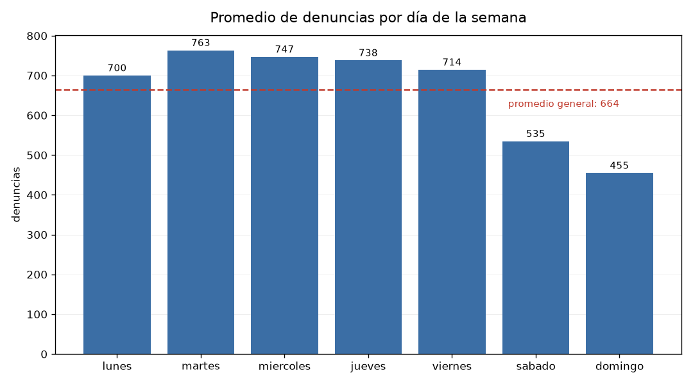
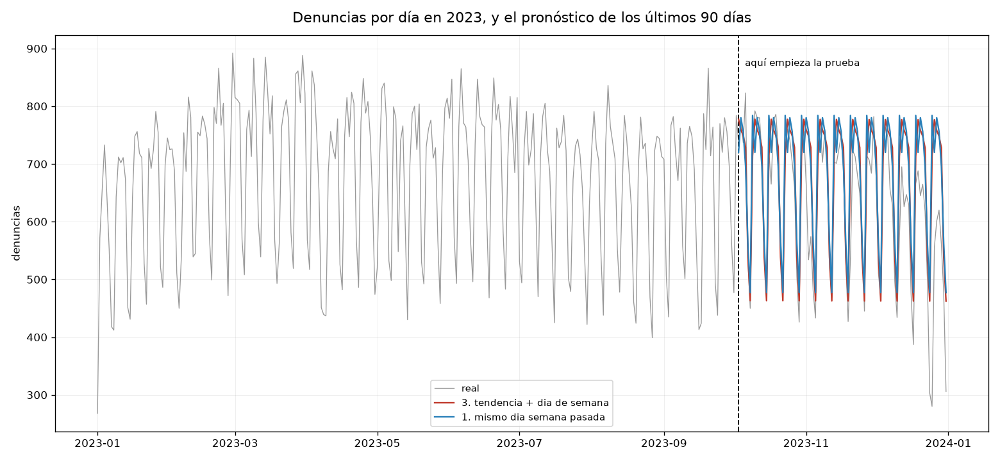

# Práctica 8 — Pronóstico sobre la serie de tiempo

```
python pronostico.py          # el reporte completo (queda en salida.txt)
python pronostico.py --demo   # comprueba las funciones con casos conocidos
```

Usa `pandas`, `numpy` y `matplotlib`. No hizo falta `scikit-learn`: los mínimos
cuadrados son una línea con `numpy.linalg.lstsq`.

## La serie

```
365 días, del 1 de enero al 31 de diciembre de 2023, sin un solo hueco
media 664.1   mediana 709   mínimo 268 (1 de enero)   máximo 892 (28 de febrero)
```

Los 365 días están completos, sin un solo hueco, y eso no es casualidad. En la
Práctica 1 se decidió usar `fecha_inicio` y no `fecha_hecho` precisamente por esto:
`fecha_inicio` es cuándo se abrió la carpeta y cubre los 365 días de 2023;
`fecha_hecho` es cuándo ocurrió el delito y llega hasta 1957, con huecos enormes,
porque hay denuncias de hechos viejos.

Esa decisión, tomada seis prácticas antes y por otras razones, es la que hace posible
esta. Una serie de tiempo con huecos obliga a inventar los días faltantes o a
tirarlos, y las dos cosas contaminan el pronóstico.

## 1. Cómo se evalúa un pronóstico sin tener el año siguiente

Un modelo de pronóstico se mide prediciendo algo que no vio. Pero no hay datos de
2024, así que se apartan los últimos días de 2023.

El corte **no puede ser al azar** como en la Práctica 6. Si se entrena con días
revueltos de todo el año, el modelo ve el futuro: para predecir el 15 de diciembre
estaría usando el 20 de diciembre, que en la vida real todavía no pasó.

```
ene ───────────────────── 2 oct │ 3 oct ───── 31 dic
├───── 275 días, entrenar ──────┤├── 90 días, probar ──┤
```

Se apartaron 90 días en vez de 30 o 60 para tener un periodo de prueba largo: con 30
días, un par de semanas raras podrían decidir el resultado.

El costo es que el corte deja la prueba en el tramo bajo del año. La media del
entrenamiento es 676.9 denuncias por día y la de la prueba 625.0, un 7.7% menos,
porque noviembre (634) y diciembre (568) son los meses más flojos.

Eso se sabía antes de correr nada y no se puede evitar: con un solo año, cualquier
corte cronológico deja la prueba al final, y el final de este año es bajo. Lo que sí
se puede hacer es decirlo, porque explica parte del error de los seis modelos.

## 2. Qué estructura tiene la serie



| | promedio |
|---|---|
| martes | 763.5 |
| miércoles | 747.0 |
| jueves | 738.1 |
| viernes | 714.4 |
| lunes | 700.1 |
| sábado | 534.8 |
| domingo | 454.8 |

```
diferencia entre el día más alto y el más bajo:   309 denuncias
diferencia entre el mes más alto y el más bajo:   165 denuncias
```

El día de la semana manda. Entre el martes (763) y el domingo (455) hay 309 denuncias
de diferencia; entre el mes más alto y el más bajo hay 165. El patrón semanal pesa
casi el doble que el estacional.

Y la caída es abrupta, no gradual: de lunes a viernes todo ronda las 700 a 760, y el
sábado se cae a 535 y el domingo a 455.

Eso no es que haya menos delitos el fin de semana. Es que el Ministerio Público opera
distinto: menos agencias abiertas, menos personal. Lo que se está midiendo es el
horario de la institución, igual que en la Práctica 3, donde el valle de las 5 de la
mañana en la curva de las horas era el horario del MP y no el del crimen.

## 3. Los seis modelos

El modelo 0 es el punto de comparación, igual que el "modelo tonto" de la Práctica 6:
si un modelo no le gana, no sirve.

| modelo | qué usa | MAE | MAPE | sesgo |
|---|---|---|---|---|
| 3. tendencia + día de semana | recta + ajuste por día | **59.9** | 11.4% | −50 |
| 5. solo día de semana | solo el ajuste por día | 61.1 | 11.7% | −52 |
| 1. mismo día semana pasada | el último martes para el próximo martes | 69.0 | 13.2% | −56 |
| 2. solo tendencia | una recta | 103.3 | 20.9% | −48 |
| 0. la media de siempre | nada | 103.7 | 21.1% | −52 |
| 4. tendencia + día + mes | todo lo anterior más el mes | **242.4** | 43.6% | −241 |

El MAE está en denuncias: "en promedio me equivoco por tantas". El sesgo negativo
quiere decir que el modelo predice de más.



El mejor modelo se equivoca por 59.9 denuncias al día, contra 103.7 de predecir
siempre el promedio. Una mejora del 42.3%, y todo viene del patrón semanal.

Lo más interesante de la tabla es el modelo 1. "El martes que viene será como el
martes pasado" no tiene parámetros, no se ajusta a nada, y queda a 9 denuncias del
mejor modelo de regresión. Cuando el patrón semanal es así de fuerte, repetir la
semana anterior es casi tan bueno como ajustar una regresión.

La gráfica muestra las dos caras. Por un lado, los pronósticos siguen la forma de la
serie real: la misma onda semanal, 13 veces seguidas, sin fallar el ritmo.

Por otro, los dos fallan exactamente en los mismos lugares. A fin de diciembre la
línea real se desploma a 280-300 por Navidad y Año Nuevo, y los pronósticos siguen
tercos en 460. El mismo hueco aparece al inicio del año: el 1 de enero tiene 268
denuncias, el mínimo de los 365 días.

Ninguno de los modelos sabe qué es un día festivo. Y los festivos son justo donde más
se equivocan.

## 4. El modelo que empeoró al darle más información

El modelo 4 es el que más sabe —tendencia, día de la semana **y** mes— y es el peor
de los seis por mucho. Más del doble de error que no hacer nada.

El entrenamiento termina el 2 de octubre. Estos son los días que vio de cada mes:

| mes | días en el entrenamiento | coeficiente que estimó |
|---|---|---|
| enero a septiembre | 28 a 31 cada uno | de +46 a −194 |
| octubre | **2** | −155.6 |
| noviembre | **0** | +0.0 |
| diciembre | **0** | +0.0 |

Y la prueba son octubre (29 días), noviembre (30) y diciembre (31).

El modelo 4 tiene que predecir tres meses de los que vio dos días en total, y lo que
hace con ellos es el problema.

A noviembre y diciembre les puso coeficiente **cero**. Pero cero no significa "este
mes no tiene efecto": significa "este mes se comporta como enero", porque enero es la
referencia contra la que se miden todos los demás. Y enero promedia 622 denuncias
mientras diciembre promedia 568. El modelo predice diciembre como si fuera enero.

El de octubre es peor. Estimó un coeficiente de −155.6 a partir de **dos días**, que
además cayeron en domingo y lunes. Luego aplica ese −155.6 a los 29 días de octubre
que hay en la prueba.

El contraste con el modelo 0 es lo que vale la pena notar. El modelo 0 no sabe nada y
predice el promedio, así que nunca se equivoca por mucho. El modelo 4 cree que sabe y
se equivoca con confianza: su peor día falla por 713 denuncias.

**Un modelo mal especificado es peor que ninguno.**

## 5. La tendencia que no existe

El modelo 3 (con tendencia) le gana al modelo 5 (sin tendencia) por 1.26 denuncias de
MAE, sobre un error de 60. Un 2%.

Y el coeficiente de tendencia dice esto:

```
+0.961 denuncias por día   ->   +351 denuncias al año
```

O sea, que las denuncias van subiendo. Pero los promedios por mes bajan:

```
marzo      734     el más alto
diciembre  568     el más bajo
```

La tendencia aporta 1.26 denuncias de MAE sobre 60, o sea el 2%. Y ni siquiera eso es
confiable.

El coeficiente dice +0.961 denuncias por día, que serían +351 al año: las denuncias
estarían subiendo. Pero los promedios mensuales van de 734 en marzo a 568 en
diciembre, o sea bajando.

La contradicción se explica por dónde empieza la recta. Se ajustó con enero a
octubre, y enero es un mes bajo (622). La recta sube porque arranca abajo, no porque
haya una tendencia real.

Y el problema de fondo es el que ya estaba desde el principio: **con un solo año no se
puede separar la tendencia de la estacionalidad anual**. Para saber si diciembre baja
porque hay una tendencia a la baja o porque diciembre siempre es bajo, harían falta al
menos dos años.

Por eso el modelo que se reporta es el **5, solo día de semana**, aunque su MAE sea
1.26 peor que el del 3. La tendencia del modelo 3 es un artefacto de dónde cayó el
corte, y un modelo que no la incluye no está peor informado: está menos equivocado.

## 6. El sesgo de todos los modelos

Los seis predicen de más, entre 48 y 56 denuncias por día (el modelo 4, 241).

```
media del entrenamiento (ene a oct)   676.9
media de la prueba (oct a dic)        625.0     −7.7%
```

El corte cronológico dejó la prueba en el tramo bajo del año, así que cualquier
modelo entrenado con enero a octubre va a predecir de más en octubre a diciembre. Los
seis se equivocan en la misma dirección y por una cantidad parecida, entre 48 y 56
denuncias.

Eso no es un fallo de los modelos: es consecuencia de dónde cayó el corte. Y conviene
decirlo, porque si no parece que los seis fallan por la misma razón misteriosa.

**Qué se podría hacer.** Con un solo año, poco. Se podría usar una ventana móvil,
entrenando con los últimos 60 días antes de cada predicción en lugar de con todo el
histórico, y eso reduciría el sesgo porque el modelo se adaptaría al nivel reciente.
Pero también lo haría más sensible al ruido, y con 90 días de prueba no hay forma de
comprobar cuál de los dos efectos gana. Con dos años sí se podría.

---

## 7. Conclusión

El modelo que se reporta es el 5: predecir cada día según su día de la semana, sin
tendencia ni mes. Se equivoca por 61 denuncias al día sobre un promedio de 625, o sea
un 11.7%.

En términos entendibles: **en promedio le erra por uno de cada nueve**. Para planear
personal con una semana de anticipación eso alcanza; para decidir cuántas agencias
abrir un día específico, no.

Lo que le falta para servir de verdad son dos cosas. Primero, los días festivos: ahí
es donde más falla, y son predecibles con un calendario, sin necesidad de ningún
modelo. Segundo, más de un año, para poder separar la tendencia de la estacionalidad
en lugar de tener que reportar que no se puede.

### Lo que esta práctica agrega al hilo de las anteriores

En las prácticas 5, 6 y 7 el patrón era que la métrica mejor correspondía al modelo
menos útil. Aquí aparece uno distinto.

En las prácticas 5, 6 y 7 el patrón era que la métrica mejor correspondía al modelo
menos útil. Aquí aparece otro, distinto pero emparentado.

El modelo con más información, con tendencia, día de la semana y mes, fue el peor de
los seis. Y el más simple de todos, "el martes que viene será como el martes pasado",
que ni siquiera tiene parámetros, quedó a 9 denuncias del mejor.

**Más información no es mejor modelo cuando esa información no se pudo estimar con los
datos que había.** El modelo 4 no falló por tener la columna de mes: falló porque esa
columna requería datos de noviembre y diciembre que el entrenamiento no contenía.

Junto con lo anterior, la lección acumulada es que lo que decide si un modelo sirve no
es cuánto sabe ni qué tan buena se ve su métrica, sino si lo que sabe se pudo medir
con los datos disponibles.
