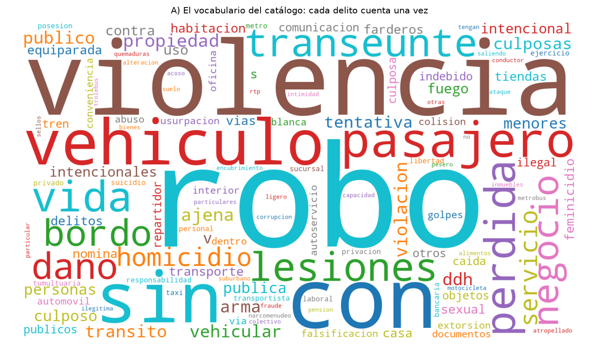
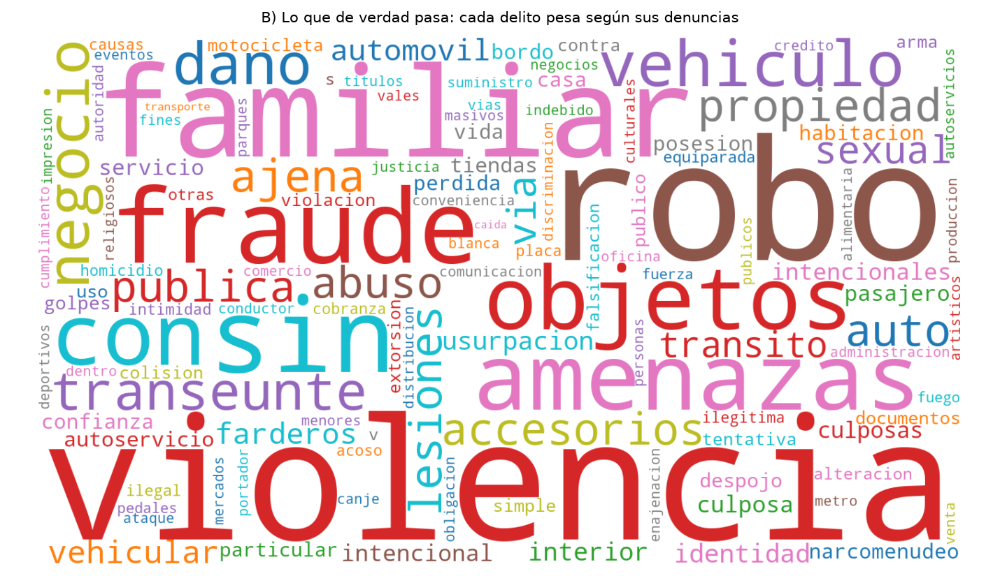
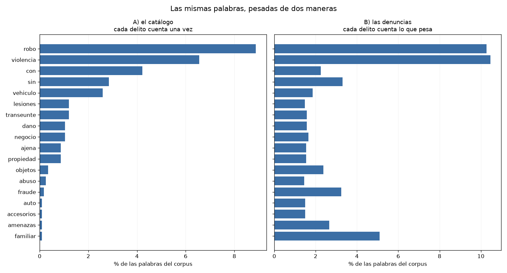

# Práctica 9 — Análisis de texto

```
python texto.py          # el reporte completo (queda en salida.txt)
python texto.py --demo   # comprueba las funciones con casos conocidos
```

Necesita `wordcloud`. El texto analizado es la columna `delito`.

## El corpus

```
286 etiquetas distintas, repartidas en 242,392 denuncias
409 palabras distintas (después de quitar conectores)
5.66 palabras por etiqueta en promedio, de 1 a 29
24 etiquetas de una sola palabra, 12 de más de diez
```

La más larga tiene 29 palabras:

> CORRUPCIÓN DE PERSONAS MENORES DE EDAD O PERSONAS QUE NO TENGAN CAPACIDAD PARA
> COMPRENDER EL SIGNIFICADO DEL HECHO O DE PERSONAS QUE NO TENGAN CAPACIDAD DE
> RESISTIR LA CONDUCTA

---

## 1. Las dos formas de contar

Una nube de palabras dibuja cada palabra más grande entre más frecuente sea. Pero
hay dos maneras de contar la frecuencia, y dan resultados distintos:

```
A)  cada una de las 286 etiquetas cuenta UNA vez
    SECUESTRO cuenta 1,  VIOLENCIA FAMILIAR cuenta 1

B)  cada etiqueta cuenta lo que pesa en denuncias
    SECUESTRO cuenta 20,  VIOLENCIA FAMILIAR cuenta 37,838
```

Se hacen las dos porque cuentan cosas distintas, y quedarse con una sola sería
escoger una respuesta sin decir que había otra.

La versión A trata cada etiqueta igual: `SECUESTRO` y `VIOLENCIA FAMILIAR` pesan lo
mismo, aunque una tenga 20 casos y la otra 37,838. Eso describe el vocabulario del
catálogo. La versión B pesa cada etiqueta según sus denuncias, y describe lo que de
verdad ocurre.

Es la misma tensión que apareció en las tres prácticas anteriores: la estructura
fuerte contra la sutil. En la Práctica 5 fueron conteos contra proporciones, en la 6
fue la clase mayoritaria que se come el accuracy, en la 7 fue el tamaño de la colonia
dominando el clustering. Aquí la estructura fuerte es la frecuencia de las denuncias.

La diferencia con los casos anteriores es que esta vez las dos versiones son
legítimas. No hay una buena y una trampa: hay dos preguntas distintas.

## 2. La lista de palabras vacías es propia, no la de la librería

En análisis de texto se quitan los conectores (*stopwords*) porque aparecen en todo y
no distinguen nada. Pero una lista genérica aquí haría daño:

```
ROBO A TRANSEUNTE EN VÍA PÚBLICA   CON   VIOLENCIA
ROBO A TRANSEUNTE EN VÍA PÚBLICA   SIN   VIOLENCIA
```

Lo que se quitó y lo que se conservó:

| | palabras |
|---|---|
| se quitan | de, del, la, el, los, las, en, y, o, a, al, por, para, que, su, sus, un, una, lo, se |
| **se conservan** | **con**, **sin**, **no**, **contra** |

Se conservan cuatro que una lista genérica habría quitado, y cada una por su razón.

`con` y `sin` son las más importantes: `ROBO A TRANSEUNTE EN VÍA PÚBLICA CON
VIOLENCIA` y `... SIN VIOLENCIA` son dos delitos distintos, con penas distintas.
Quitarlas los volvería la misma etiqueta. `no` aparece en `HECHO NO DELICTIVO`, donde
invierte el significado completo. `contra` aparece en `DELITOS CONTRA LA SALUD`.

En cambio `a` sí se quita, aunque sea de la misma familia gramatical. Aparece en
`ROBO A TRANSEUNTE`, `ROBO A NEGOCIO`, `ROBO A CASA HABITACIÓN`, `ROBO A REPARTIDOR`:
está en casi todas las etiquetas de robo, así que no distingue ninguna de las otras.

El criterio no es gramatical, es si la palabra separa unas etiquetas de otras en este
corpus. **La lista de palabras vacías depende del corpus; no es universal.**

---

## 3. Las dos nubes

**A) El vocabulario del catálogo**



**B) Lo que de verdad pasa**



Las mismas palabras, pesadas de las dos maneras:



Las dos nubes están hechas con el mismo texto y no se parecen.

El caso más claro es `familiar`. En la nube del catálogo no aparece; en la de
denuncias es de las palabras más grandes. La razón es que `VIOLENCIA FAMILIAR` es
**una sola entrada** del catálogo y **37,838 denuncias**: una palabra en la versión A,
37,838 en la B.

Al revés pasa con `vida`, `bordo`, `pasajero` y `homicidio`, que son grandes en el
catálogo y chicas o ausentes en las denuncias. `vida` está en el lugar 8 del catálogo
porque aparece en todas las variantes de `PÉRDIDA DE LA VIDA POR...`, que son muchas
etiquetas y pocos casos.

La gráfica de barras lo muestra sin la distorsión de la nube: `familiar`, `fraude` y
`amenazas` tienen barras casi invisibles en el panel A y de las más largas en el B.

### Las palabras que cambian de lugar

| solo en el catálogo | lugar | solo en las denuncias | lugar |
|---|---|---|---|
| vida | 8 | familiar | 3 |
| homicidio | 14 | fraude | 5 |
| violacion | 18 | amenazas | 6 |
| arma | 21 | objetos | 7 |
| tentativa | 25 | accesorios | 15 |
| menores | 30 | abuso | 18 |
| fuego | 32 | sexual | 21 |
| feminicidio | 40 | narcomenudeo | 38 |

Y dos que no desaparecen pero se mueven mucho:

```
pasajero    lugar  6 en el catálogo    lugar 34 en las denuncias
servicio    lugar 15 en el catálogo    lugar 33 en las denuncias
```

La división es casi limpia:

```
CATÁLOGO     delitos graves y contra la persona
             vida, homicidio, violación, arma, tentativa, menores, fuego, feminicidio

DENUNCIAS    delitos patrimoniales y cotidianos
             familiar, fraude, amenazas, objetos, accesorios, abuso, narcomenudeo
```

Y la explicación es que **un catálogo legal no es una lista de frecuencias, es una
taxonomía jurídica.**

La ley necesita distinguir homicidio doloso de culposo, de feminicidio, de lesiones
que causan la muerte, porque cada uno tiene pena distinta y procedimiento distinto.
Por eso hay muchas etiquetas, muchas palabras, y pocos casos en cada una.

Del otro lado, `ROBO DE OBJETOS` cubre una variedad enorme de hechos reales bajo una
sola etiqueta, porque el tratamiento legal es el mismo. Una etiqueta, 17,564
denuncias.

**El vocabulario del catálogo es proporcional a la consecuencia jurídica, no a la
frecuencia.**

---

## 4. Bigramas

Los pares de palabras seguidas. Aquí **no** se quitan los conectores: `con violencia`
y `arma de fuego` se rompen si se quitan.

| en el catálogo | | en las denuncias | |
|---|---|---|---|
| robo a | 62 | robo de | 40,435 |
| con violencia | 43 | violencia familiar | 37,838 |
| robo de | 34 | robo a | 33,123 |
| sin violencia | 32 | sin violencia | 24,315 |
| de la | 23 | de objetos | 17,564 |
| a pasajero | 22 | con violencia | 15,355 |
| perdida de | 16 | a negocio | 11,955 |
| la vida | 16 | a transeunte | 11,607 |

Los bigramas recuperan lo que las palabras sueltas pierden: `violencia` sola no dice
nada, pero `con violencia` y `sin violencia` son categorías distintas.

Y ahí aparece algo que las nubes no mostraban. En el catálogo, `con violencia` (43) le
gana a `sin violencia` (32). En las denuncias se invierte: 15,355 contra 24,315.

O sea que **el catálogo tiene más variantes con violencia, pero en la realidad se
denuncia más sin ella.** Es el mismo patrón de toda la práctica: el catálogo se
detalla donde la consecuencia es grave, no donde los casos son muchos.

El otro contraste es `violencia familiar`, el segundo bigrama de las denuncias con
37,838, que ni aparece entre los doce primeros del catálogo porque es una sola
etiqueta.

## 5. Cobertura del vocabulario

Cuántas palabras distintas hacen falta para cubrir cierto porcentaje del texto:

| | 50% | 80% | 90% |
|---|---|---|---|
| A) catálogo | 34 palabras | **177** | 293 |
| B) denuncias | 15 palabras | **53** | 94 |

De un vocabulario total de 409 palabras.

Con **53 palabras** se cubre el 80% de todo el texto que generan las 242,392
denuncias. Al catálogo le hacen falta **177** para cubrir el mismo porcentaje de su
vocabulario, más del triple.

Eso pone número a lo que las nubes mostraban. La delincuencia real está concentrada en
un puñado de situaciones que se repiten: robo, violencia familiar, fraude, amenazas,
daño en propiedad ajena. Con medio centenar de palabras se describe casi todo lo que
pasa.

El catálogo reparte su atención mucho más: 409 palabras para distinguir 286
situaciones jurídicas, la mayoría de las cuales ocurre pocas veces al año.

Y eso no es un defecto del catálogo. Es que **cubrir casos frecuentes y cubrir casos
graves son objetivos distintos**, y el catálogo está hecho para el segundo.

---

## 6. Conclusión

En un reporte pondría **las dos nubes**, y el contraste como hallazgo.

Si se pone solo la B, parece que el homicidio no es un problema de la ciudad: la
palabra apenas se ve. Si se pone solo la A, parece que la CDMX está llena de
feminicidios y secuestros. **Las dos son ciertas y las dos engañan solas.**

La respuesta a "¿qué pasa en la CDMX?" es la B: robo, violencia familiar, fraude y
amenazas. Pero la A contesta otra pregunta que también importa, que es cómo clasifica
la institución y dónde pone su atención.

Lo que aprendí de esto es que en una nube de palabras la decisión de qué contar es más
importante que la nube misma, y casi nunca se declara.

### La limitación honesta de esta práctica

`delito` es **texto de catálogo, no redacción libre**. Son 286 etiquetas escritas por
la institución y reutilizadas 242,392 veces, no 242,392 relatos distintos.

Eso tiene dos consecuencias. La primera es que el vocabulario es chico y repetitivo:
409 palabras en total, y las etiquetas comparten estructura (`ROBO A...`, `CON Y SIN
VIOLENCIA`). La segunda es que lo que se analiza es **cómo la institución nombra los
hechos**, no cómo los describieron las víctimas.

La narración de los hechos sí existe, en el expediente de cada carpeta, pero el portal
de datos abiertos no la publica. Con ella se podrían hacer cosas que aquí no: detectar
temas sin usar el catálogo, medir el lenguaje de quien denuncia, o encontrar patrones
que las etiquetas borran.

Lo que sí se pudo hacer con este texto es comparar dos formas de pesarlo, y eso
resultó dar más que una nube sola.

### Lo que esta práctica agrega al hilo

```
prácticas 5, 6 y 7    la métrica que sale mejor corresponde al modelo menos útil
práctica 8            más información no es mejor modelo si no se pudo estimar
práctica 9            ?
```

Es la cuarta vez que aparece el mismo patrón: la estructura fuerte tapa la sutil. Aquí
la fuerte es la frecuencia de las denuncias y la sutil es la composición del catálogo.

Pero hay una diferencia con las tres anteriores. En las prácticas 5, 6 y 7 una versión
era la buena y la otra la trampa: el R² de 0.215 medía el tamaño, el F1 de 0.243
marcaba el 86% de todo, la silueta de 0.730 partía chicas contra grandes. Aquí **las
dos versiones son legítimas y contestan preguntas distintas**.

O sea que el patrón no siempre es una trampa. A veces es nada más una decisión que hay
que declarar: qué se está contando, y por qué.
